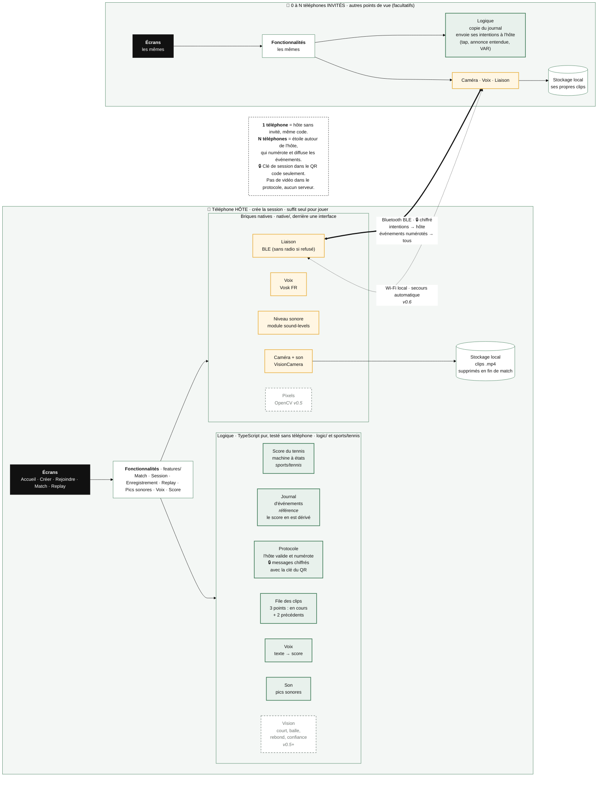

# Architecture

Ce qui tourne sur chaque téléphone en **v0.4**, et ce qui circule entre eux. En pointillé : prévu, pas encore construit. Un téléphone seul est un hôte sans invité : même code de 1 à N téléphones. Chaque fonctionnalité range sa logique dans `logic/` et ses briques natives dans `native/` ; le détail des dossiers et des règles est dans [`CLAUDE.md`](../CLAUDE.md#architecture).

Image pour les slides : [`images/architecture.png`](images/architecture.png) (`npm run docs:images` la regénère depuis ce fichier).

