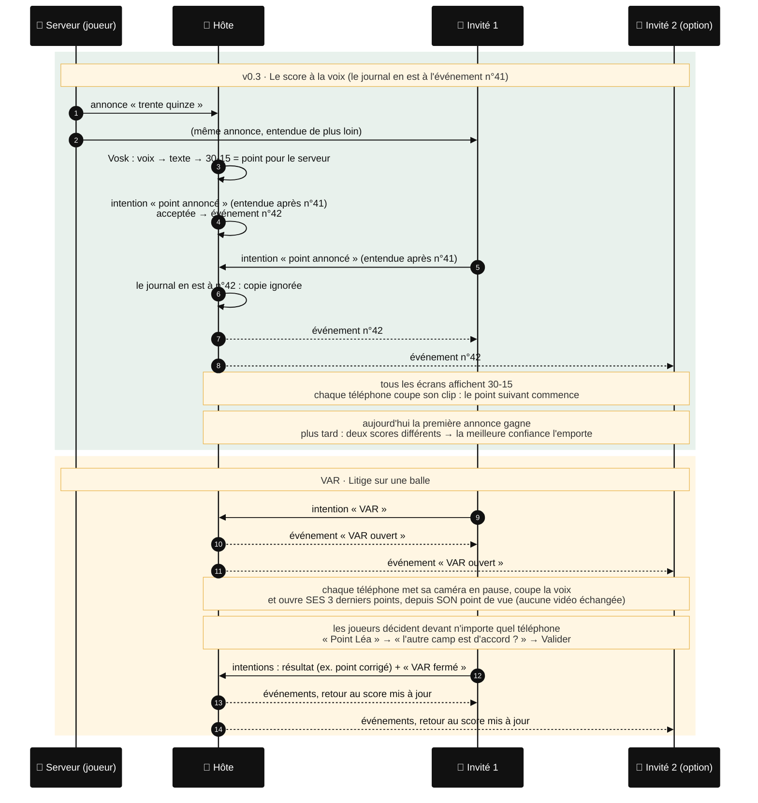

# Synchronisation

Comment une annonce vocale et un VAR passent d'un téléphone à tous les autres, en **v0.4**. Chaque téléphone écoute ; l'hôte garde une seule version et la diffuse. Chaque message est chiffré et signé avec la clé du QR code. Le protocole est décrit dans [`CLAUDE.md`](../CLAUDE.md#protocole-de-partage--un-journal-ordonné-par-lhôte).

Image pour les slides : [`images/synchro.png`](images/synchro.png) (`npm run docs:images` la regénère depuis ce fichier).

